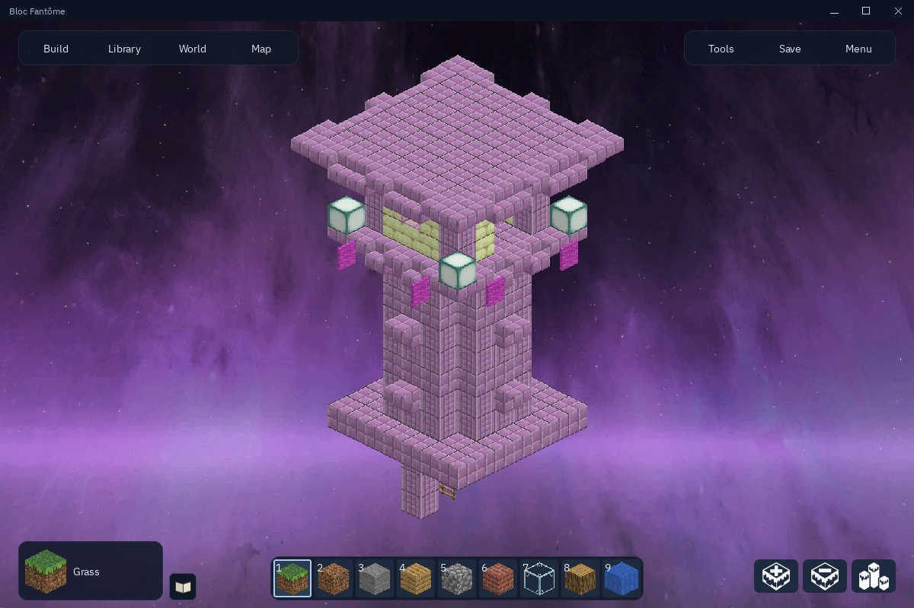
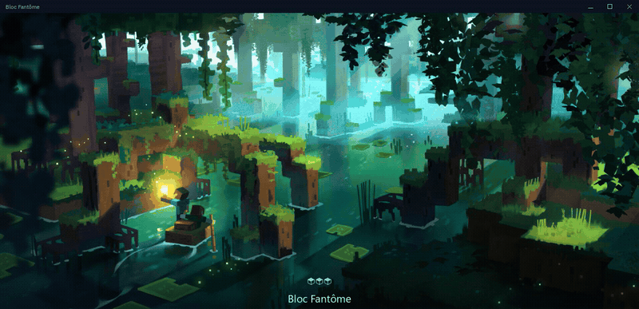
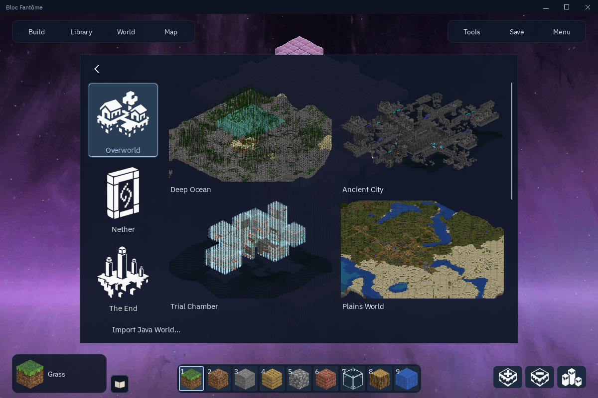
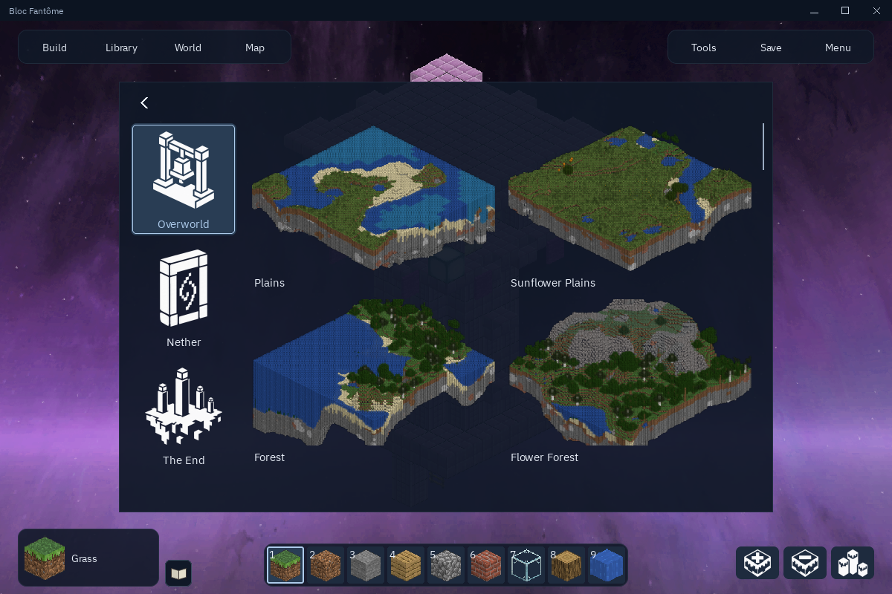
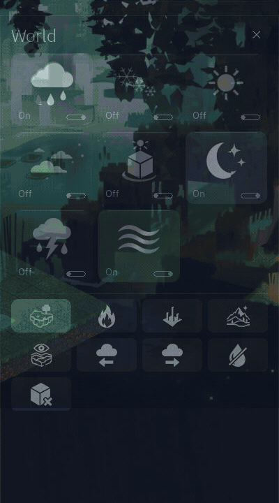
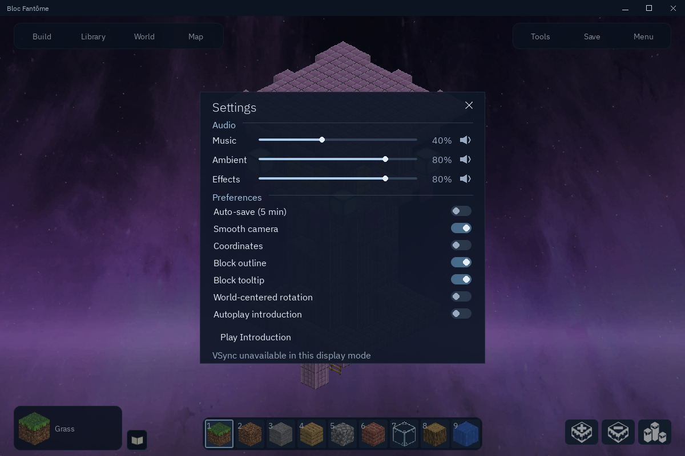
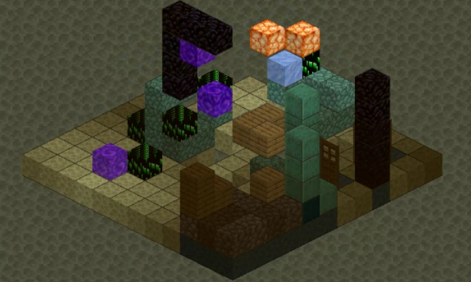
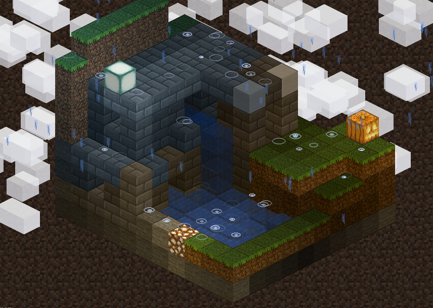

# Bloc Fantôme

<!-- Do not remove this comment. It is important. -->
<!-- The gallery remembers those who visited. -->

An isometric building sandbox by Jeffrey Morais. Place a block, build a quiet corner of the world, and see what lies beyond it.

> This is an unofficial fan project, not affiliated with or endorsed by Mojang Studios or Microsoft. Minecraft textures and sounds must come from your own Java Edition installation, version 1.21.1 or later. Minecraft® is a registered trademark of Mojang Synergies AB.



## Version 3.3.0

Rain falls in layers, lands on raised roofs and blocks, and leaves splashes and water ripples. Its sound shifts with the weather and nearby materials. Slow fog banks soften distant buildings while the foreground stays clear.

The workshop has a new title bar, floating controls, IBM Plex typography and square outer panels. The smaller buttons and preview cards stay rounded. Text renders at its selected display size, and Reduced Motion is available from Menu.



The full swamp painting leads into the editor. Startup and Goodbye have their own short presentation and audio handoffs. The optional manual Introduction does not autoplay by default.

## Building

Choose materials in **Build**, then place them on the canvas. The held-block preview shows the placement before you click. **Tools** contains brushes, fill, selections, clipboard rotation, mirrors and block adjustments. Undo and redo retain editable world state.

The canvas can grow or shrink around its center. Terrain slices and local noise provide a starting landscape; they are artistic generators, separate from imported Java worlds. Water, lava, fire, portals and interactive blocks retain their individual behavior.

Save a named build, reopen it through **Library**, or use the quick-save slots. Saving uses an atomic write and keeps recovery copies. Keep your own backups too.

*The world remembers every block you place.*

## Library

**Dimensions**, **Biomes**, **Structures** and **Saved Builds** share a preview gallery. Dimension scenes include villages, bastions, End locations, Ocean Monument, Ancient City and Trial Chamber. Entries identify their source version; a captured location is not a claim that the application recreates Minecraft's world generator.



The featured biome collection contains 37 scenes. Swamp and Small End Islands use documented source subsets: the original captures remain intact, and the preview opens the same selected cells. Small End Islands shows three complete, separated islands.



**Import Java World** reads supported Anvil region data from a local Java save. The interactive tutorial, World Map and Redstone Lab remain available through the workshop.

## World and sound

**World** controls the dimension, weather, light, skybox and liquid simulation. Its drawer stays open while you make changes. Close it with X or Escape. Clouds, rain, snow, sunlight, moonlight and liquid controls have distinct motion, with accurate On/Off states.



World and Tools use shorter, quieter interaction cues. Ordinary music transitions occasionally select a complete opening piano chapter; the separate startup, map and Goodbye cues keep their own routing. Settings provides independent music, ambience and effects controls.



## Controls

| Input | Action |
| --- | --- |
| Left click | Place the previewed block |
| Right click | Remove or interact |
| Middle drag / WASD | Move the camera |
| Mouse wheel | Zoom |
| Q / E | Rotate the view |
| Ctrl+Z / Ctrl+Y | Undo / redo |
| Ctrl+S | Save |
| Home | Fit the world |
| Escape | Close the active drawer or cancel the active interaction |

The Tools hotkey list and Menu help describe the remaining shortcuts. Window dragging, resizing, fullscreen and floating-window restore are available from the title bar and Menu.

## Run from source

Python 3.12 is the tested version. From the repository root:

```powershell
python -m pip install -r requirements.txt
python Code/setup_assets.py
python Code/blocFantome.py
```

The setup script extracts ordinary Minecraft assets from an owned local installation. It does not supply the selected audio, licensed fonts, skyboxes or other private release inputs. See [Local assets and recovery](docs/LOCAL_ASSET_LAYOUT.md) before restoring a checkout or building the full local Windows edition.

```powershell
python Code/tools/check_local_assets.py
python Code/build_exe.py --output-dir .qa/release
```

The local executable expects its adjacent Assets folder. No binary containing private or Minecraft-extracted media is distributed by this release. Development and verification instructions are in [CONTRIBUTING.md](CONTRIBUTING.md).

## Known limits

Large captured worlds can stall during camera rebuilds, edits, loading and saving. The 3.3 review measured Trial Chamber cached loading near 3 seconds and cold view rebuilds near 129 ms. Ocean Monument's full-frame p95 was 19.1 ms during the sustained run. Memory grew across scene changes; a stable whole-process plateau has not been established. These are measurements from one Windows machine, not performance guarantees.

Physical keyboard and Windows Snap coverage is recorded separately from automated SDL event checks in the [release QA record](docs/releases/3.0.0.md). See [CHANGELOG.md](CHANGELOG.md) for the release history.

## Credits

- **Jeffrey Morais**, original author.
- **[Mojang Studios](https://www.minecraft.net/)**, creators of Minecraft. Please support the official game.
- **[Minecraft Wiki](https://minecraft.wiki/)**, technical reference material.
- **[Pygame](https://www.pygame.org/)** and its community.
- **IBM Plex**, with its [bundled Open Font License](Code/ui/fonts/IBMPlexSans/OFL.txt).
- **Ewan Howell**, creator of the locally supplied Black Mesa skybox pack. Other supplied media retain their original attribution and licensing records.

See [LICENSE](LICENSE) and the [asset register](docs/design/ASSETS.md). Source-code licensing does not grant rights to redistribute extracted or privately licensed media.

*...and to those who watch from beyond the render distance*

---



<br>

<p align="center">
  
</p>

<br>

---

<p align="center">
  
</p>

<br>

<p align="center"><i>???</i></p>

<br>

<p align="center"><sub>The gallery is quiet now.</sub></p>

<p align="center"><sub>You have viewed all the paintings.</sub></p>

<br>

<p align="center"><sub>. . .</sub></p>

<br>

<p align="center"><sub>Merci de votre visite.</sub></p>

<p align="center"><sub>Revenez bientôt.</sub></p>

<br>

<p align="center"><sub><i>Édition Miette</i></sub></p>

<br>
<br>

<!-- Mary was here. -->
<!-- You found this. Why were you looking? -->
