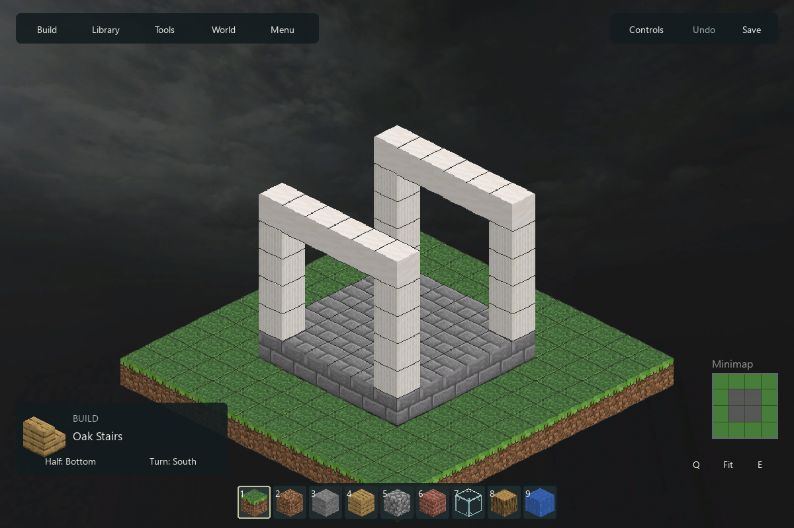

# Pass 1: anchored workshop, native typography and architectural sound

Historical evidence. Local-only artifacts are recorded as paths; see the [recovery index](../../QA_ARCHIVE.md). Acceptance statements below describe that review date, not the current release.

Review continuation of the owner-approved `f63db3ab` composition, on `codex/pass1-owner-review-2026-10-20`. The current implementation is ready for visual/listening review, **not installation approval**. Performance and acceptance holds below remain explicit. No creature work, installed-game replacement or main promotion.

Verified source: [`98fc6485`](https://github.com/IsolatedSingularity/Bloc-Fantome/commit/98fc6485fc6575c0bbd0210722836592859f4d8a). **464 tests passed; 45 Python-fallback checks passed; all 56 preservation targets match.**

Start with [the editor](#native-ui), [the building rise](#audio), and [remaining gates](#performance). [Exact capability destinations](CAPABILITIES.md) distinguish callable routes, tested behavior and native-input gaps.

## Source and test

The modern workshop is now the default production editor. Its full material catalog, categories, search, favorites/recent, hotbar assignment and contextual properties route into the original world, command, undo and persistence owners. Temporary Tools/World/Menu drawers replace the permanent right sidebar; Library retains real previews and explicit Open/Place. Ctrl+C and Ctrl+T now reach copy and radial symmetry without being swallowed by the older plain-key branches.

Shared Segoe UI regular/semibold, native glyph rasterization, matte surfaces and measured controls cover editor, splash, settings, help, history, Library, tutorial, map and Lab. Windows font binaries are not distributed. The original licensed font remains the fallback. Quiet mode waits four seconds; gestures, active modes and focus hold controls open. Hidden controls have no hitboxes. Pin, Always visible, reduced motion and Clean Canvas remain recoverable from Controls/F1/Ctrl+Tab. The legacy fallback remains available until owner acceptance.

**Final validation:** see [verification index](verification/RESULTS.md), [source hashes](verification/source-manifest.json) and the linked test reports. Earlier failures are retained with their diagnoses. Tests do not establish artistic acceptance or all native workflows.

## Native UI

Native Windows captures use the real production application at 960×640, 1200×800 and 1920×1080; desktop fullscreen is 1920×1200. OS DPI was measured at **120 DPI / 125%** and remained unchanged. In-app text was separately tested at 100/125/150%; this is **not** evidence of Windows 150% scaling. [Matrix](native/matrix-iteration2.json), [final camera/save checks](native/final-checks.json).

| Review shot | What to assess |
|---|---|
| [Full catalog search](native/catalog-1200.png), [large text](native/build-960-text150.png) | Native text, arbitrary materials, drawer density |
| [Library](native/library-structures.png), [Worlds](native/library-worlds.png), [Biomes](native/library-biomes.png) | Real side preview, explicit action, restrained framing |
| [Quiet](native/quiet.png), [Clean Canvas](native/clean.png), [focus](native/focus.png) | Recovery, hotbar choreography and visual hierarchy |
| [Settings](native/settings-960-text150.png), [Help](native/help-960-text150.png), [History](native/final-history-150.png) | Native 150% text and consistent controls |
| [Tutorial](native/final-tutorial-150.png), [minimized](native/tutorial-minimized-text150.png) | Readability and retained tutorial behavior |
| [World Map](native/final-map-150.png), [Lab](native/lab-text150.png), [Lab scrolled](native/lab-scrolled-text150.png) | Shared controls with original scene artwork |
| [Save error](native/save-failure-text150.png), [clear confirmation](native/final-clear-confirm-150.png) | Persistent failure and safe cancellation |
| [Fullscreen](native/final-fullscreen.png), [windowed return](native/final-windowed-return.png) | Camera anchor, zoom and native-size glyphs |

Internal iterations corrected clipped material names and drawer footers, overlapping map instructions, unscrollable enlarged Lab content, the missing tutorial minimize glyph, low-contrast map arrows, a hidden History footer and notification layering. Retained first-iteration examples: [Build](native/iterations/first-build-960-text150.png), [tutorial](native/iterations/first-tutorial-text150.png), [map](native/iterations/first-world-map-text150.png). Native fullscreen testing exposed both a wrong desktop-size query and cumulative zoom loss; three final round trips preserve the exact world anchor and zoom. A scripted compressed save/reopen preserves all 147 test blocks.

Actual mouse footage (local artifact: `native/mouse-interactions.mp4`) shows material selection, drag assignment, placement/Undo and preview interaction. Search text was set by the harness after OS keyboard injection failed to reach Pygame. The footage ends when an incomplete command-file write crashed the QA harness; the harness parser was corrected. It is **partial native interaction evidence**, not an uninterrupted full acceptance run. Batch captures use scripted app actions. Keyboard-handler tests pass, but native keyboard delivery, Windows 100/150/200%, monitor transfer and the complete save/import workflow remain unverified. These are not silently counted as passes.

## Audio

**Provisional runtime choice: B4 Chamber.** It builds on the owner's B/B3 preference with recorded foundation strain, low stone pressure, irregular masonry joints and a longer reflected settling tail. B4 Ground is the drier comparison. These are compositional candidates, not a loudness-only change. No new creature or vocal material was introduced.

- **In scene:** B4 Chamber (local artifact: `audio/opening-B4-chamber.mp4`), B4 Ground (local artifact: `audio/opening-B4-ground.mp4`).
- **Isolated:** Chamber (local artifact: `audio/B4-chamber.mp3`), Ground (local artifact: `audio/B4-ground.mp3`).
- **UI family:** audition (local artifact: `audio/ui-cues.mp3`), [cue order](audio/ui-cues.json). No hover spam.
- **Piano:** chapter-boundary audition (local artifact: `audio/piano-boundaries.mp3`), [audition positions](audio/piano-boundaries.json), [master/chapter cue sheet](audio/piano-cue-sheet.json).

Four selective lossless Sonniss GDC 2015 recordings were acquired from the per-file mirror after the bundle download was unavailable: Mechanical Wave rock/debris and BeautifulNoise stone/metal tension. [Source URLs and hashes](audio/source-provenance.json), [credits](audio/CREDITS.txt), [Sonniss terms](https://sonniss.com/gdc-bundle-license/). Original media and local license evidence remain preserved; raw packs are not published. B4 does not use the prior CC BY-NC stone study source.

The 17-second candidates have matched RMS 0.075. Their 30–180 Hz spectral-energy fractions are 63.0% and 68.4%; the 12–16 s tail remains at RMS 0.0345/0.0386. [Analysis](audio/analysis.json), [layer cue sheet](audio/cue-sheet.json). These measurements support changed weight and sustain, **not subjective quality**. Videos are offline synchronized mixes over current Windows/WGL footage, not loopback recordings; [mix provenance](audio/mix-provenance.json) records gains, timing and omitted input-dependent sounds. Assistant subjective audition was unavailable; owner listening remains the artistic gate.

The piano now chooses complete creator-marked chapters one, three and seven from the owner's 1,952-second master: 258, 215 and 200 seconds. Timing and dynamics remain intact. A shuffled queue avoids immediate repeats, decodes the next chapter off the presentation thread and stops on the encounter. The original recording is byte-identical. Mixer routing reserves opening channels while restoring eight automatic SFX channels; real SDL tests verify that paused editor loops survive and ordinary `Sound.play()` still obtains a channel.

The existing cathedral geometry, rise timing, abyss, particles, camera choreography and creature are retained. Current native opening frames and video establish their presence; this pass does not claim a newly redesigned creature or a new atmospheric-effects regression fix.

## Performance

All inherited loading/camera gates stay in force. Four shared exact painter sorts replace twelve repeated sorts; chunk indexing avoids temporary coordinate generators. Randomized tests compare all modes/rotations with native and Python sorting. Whole-load measurements do **not** justify an overall loading-speed victory claim.

| 1920×1080 scene | Blocks | Load median | Stable full-frame p95 | Edited overview rotation p95 |
|---|---:|---:|---:|---:|
| Ancient City | 153,521 | 3,466.8 ms | 10.34 ms | 611.6 ms |
| Trial Chamber | 181,698 | 4,362.8 ms | 10.77 ms | 1,074.1 ms |
| Plains village | 779,589 | 14,232.3 ms | 11.03 ms | 1,410.6 ms |

[Raw editor samples and cache accounting](performance/editor1080.json) use SDL dummy rendering, five repetitions and an isolated derived cache. Small-sample p95 is the nearest-rank maximum; cold samples remain included. These end-to-end scene loads are distinct from [cached read/prepare measurements](performance/staging-profile.json), which also remain above the 1-second gate. The inherited plains nine-versus-eight-frame hold is not cleared by these timings.

The Windows/WGL opening's 360-frame render-plus-`glFinish` interval measured p50 **27.20 ms**, p95 **36.36 ms**, p99 **43.01 ms**, max **45.45 ms**, with no frames above 50 ms. [Raw report](performance/opening1080.json). This is not a 60 FPS pass or input-to-photon measurement. Encoding/readback were outside that timed interval.

A separate native 600-action drawer loop measured handler-to-render/flip p95 **24.28 ms**, max **260.29 ms**, including the cold start. [Raw samples](performance/ui-latency.json). It meets the 100 ms p95 target for this small editor scene; it is not proof of device latency or large-world interaction performance.

## Packaged and installed

The isolated review executable is built under `.qa/pass1-complete/package/`, with a local junction to the existing Assets directory. It is not a standalone distributable installer. Archive inspection, hashes, build/launch evidence and limits are in [verification](verification/RESULTS.md). New derived audio stays in the owner's ignored Assets tree and is required by build validation; published auditions and reproduction records are separate.

**Installed:** intentionally unchanged. Root and installed rollback executables, original media, saves and settings are checked against the 56-target preservation manifest. No Start Menu changes or `main` promotion. Final visual/listening acceptance, remaining native workflows and performance holds belong to the next review decision, not to an assumed pass.
