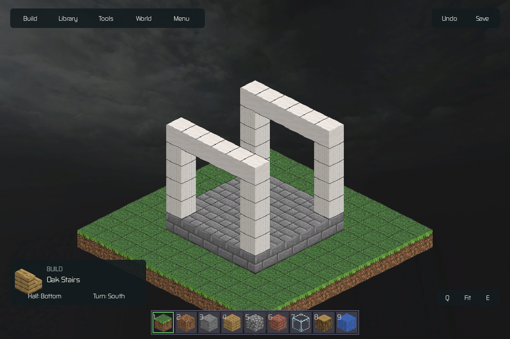
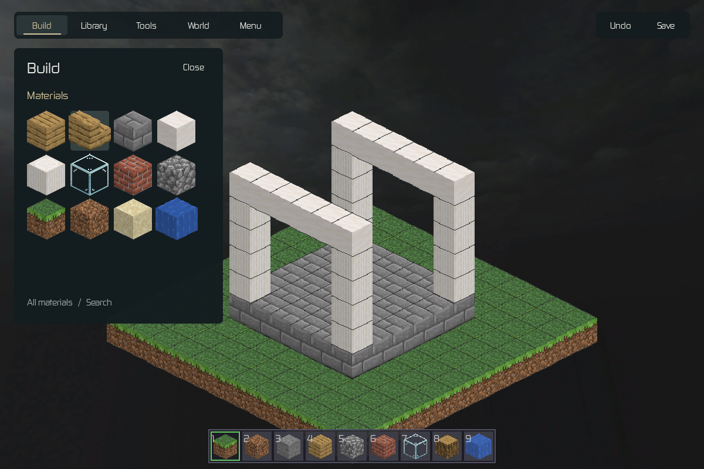
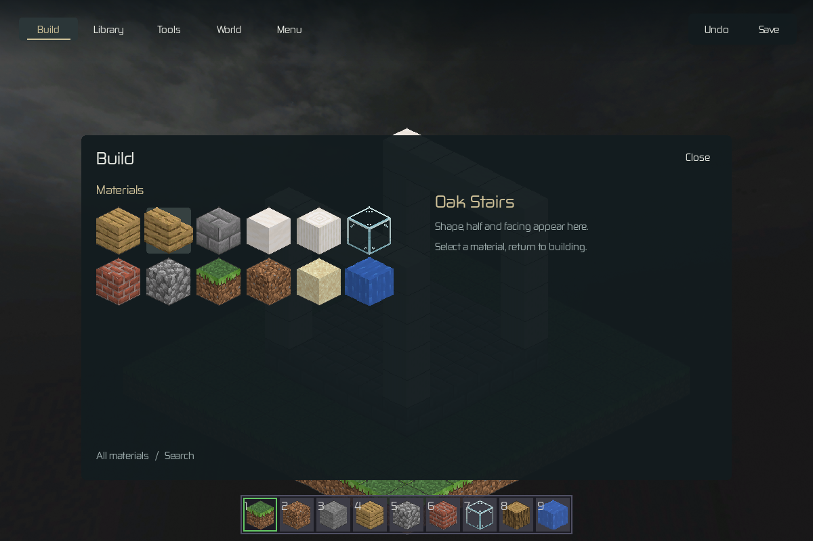
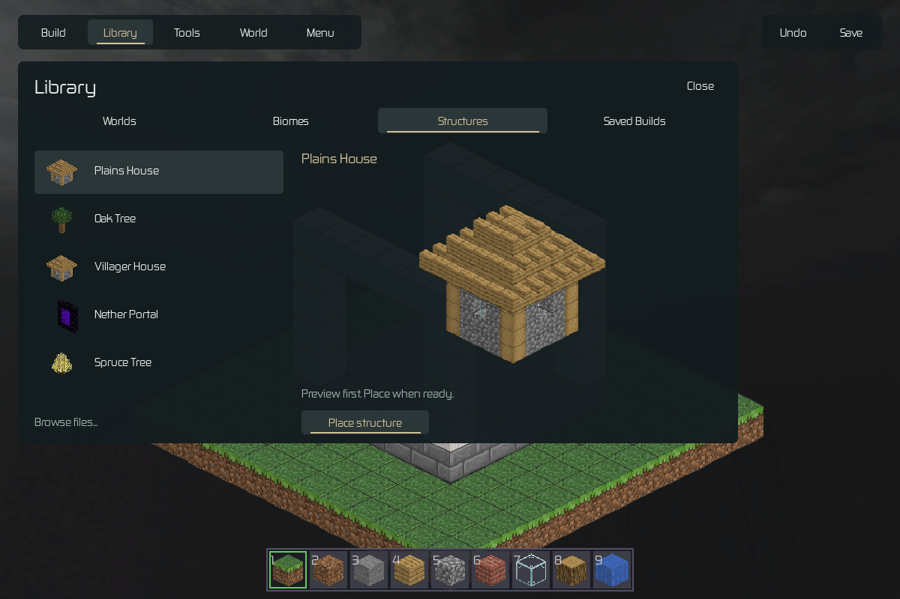

# Bloc Fantome: owner review checkpoint

Historical evidence. Local-only artifacts are recorded as paths; see the [recovery index](../../QA_ARCHIVE.md). Acceptance statements below describe that review date, not the current release.

Start here when the owner returns with feedback. This package contains actual native images, audio auditions, source and verification evidence. It is an unaccepted prototype, not a release. Main and installed executables were not replaced.

## Decision to review

The owner likes the top and lower-left UI, dislikes the permanent right sidebar and nested frames, and permits modern minimal UI while retaining the Minecraft hotbar. Preserve every editing capability and side previews. They prefer sound B but want the weight of an entire building rising, informed by Monument Valley. Creature work is deferred. Broad UI migration awaits their feedback.

Recommended: compact contextual drawers, with a larger temporary Library. Alternative: a broad temporary command desk. These are distinct isolated native studies; not all feature callbacks are migrated.

## Listen

- B2 Foundation: sustained physical weight (local artifact: `audio/B2-foundation.mp3?raw=true`)
- B3 Resonant: longer architectural resonance (local artifact: `audio/B3-resonant.mp3?raw=true`)
- Original B, peak-controlled and level-matched (local artifact: `audio/B-level-matched-reference.mp3?raw=true`)
- B2 with the cathedral rise (local artifact: `audio/B2-foundation-in-scene.mp4?raw=true`)
- B3 with the cathedral rise (local artifact: `audio/B3-resonant-in-scene.mp4?raw=true`)

Rise starts at 13 seconds in the videos. These are offline mixes over native video, not runtime loopback. The three standalone comparisons have matched RMS, not guaranteed perceptual loudness. Signal checks passed; subjective listening acceptance is pending. Existing recorded preview sources were used; no new lossless/Sonniss acquisition is claimed. [Creator credits, licenses and source hashes](audio/provenance.json). Original media remain untouched.

## Evidence and implementation scope

- Native: [three-size render checks](visual-checks.json), [125% text](anchored-text125.png), [OS pointer-selected preview](native-library-selection.jpg).
- Audio: [measurements](audio/analysis.json), [cue sheet](audio/cue-sheet.json), [mix validation and unchanged production hashes](verification.json).
- Source: [UI study](ui_study.py), [audio authoring](audio_study.py), [SuperCollider definition](audio_study.scd). These archived scripts retain their original `.qa/pass1-revision2` execution layout and local-media dependencies; they are not standalone distribution scripts.
- Tests: 438-test production run (local artifact: `final-tests.xml`), 82-test follow-up regression run (local artifact: `final-regression.xml`). These precede this isolated visual/audio revision; no new full-suite claim.
- Performance: earlier preview improvements remain; inherited cached-load and camera gates remain on HOLD. No new performance acceptance from the design studies.
- [Detailed direction and capability mapping](../../handoffs/PASS1_DIRECTION_REVISION_2026-10-20.md), [earlier engineering checkpoint](../../handoffs/PASS1_OWNER_CHECKPOINT_2026-10-20.md). Those historical documents also link local `.qa` evidence; this page contains the portable review subset.

When feedback arrives, compare it against these exact candidates. Do not treat posting this checkpoint as approval for broad UI migration, creature work, main promotion or installation. Preserve prior source fixes, all original assets and saves. The owner's later explicit request authorized committing and pushing this review branch, superseding earlier statements that the checkpoint was uncommitted.
